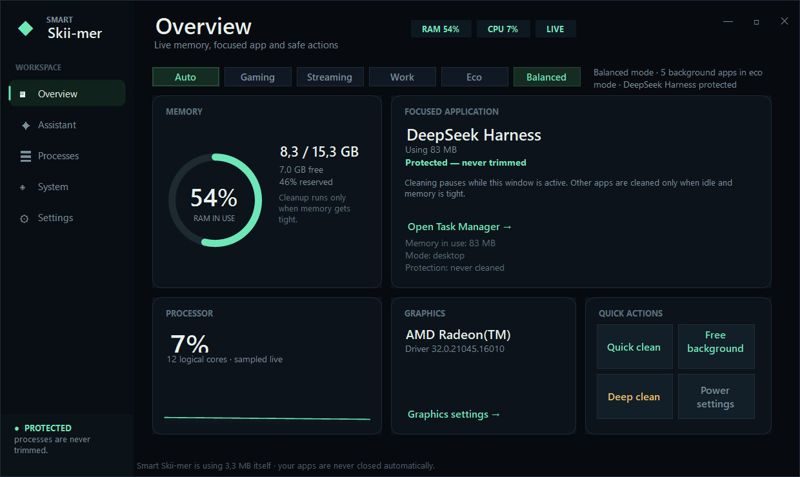

# Smart Skii-mer

**Your PC, in perfect focus.**

A local-first Windows memory assistant. It puts idle background apps into Windows **Efficiency mode (EcoQoS)**, protects whatever you're using — including games and anti-cheat — and offers device-aware advice only when you ask.

No account. No telemetry. No apps killed.

[**Download for Windows**](https://github.com/Just4Skii/smart-skii-mer/releases/latest/download/SmartSkiimer-Setup-3.2.0.exe) · [Website](https://just4skii.github.io/smart-skii-mer/) · [Report an issue](https://github.com/Just4Skii/smart-skii-mer/issues)



---

## What it actually does

| Behaviour | Mechanism |
|---|---|
| Throttles idle background apps | `SetProcessInformation(ProcessPowerThrottling)` with `PROCESS_POWER_THROTTLING_EXECUTION_SPEED`, plus idle priority |
| Never touches what you use | Foreground window, games, anti-cheat, overlay and system processes are excluded by construction |
| Frees memory | Working-set trim of idle background processes only, on a threshold + cooldown |
| Focuses a game | High GPU preference (`HKCU\...\DirectX\UserGpuPreferences`) and `AboveNormal` priority for the game executable |
| Switches posture | Auto / Gaming / Streaming / Work / Eco / Balanced, detected from the foreground app, fullscreen state and AC power |
| Advises | Optional BYO-key AI over a compact snapshot, cached for 10 minutes; local checker when no model is available |
| Phone control | LAN-only HTTP server with 4-digit pairing, bearer token and a fixed command allow-list |

It does **not** change drivers, fan curves, clocks, or kill processes.

## Install

1. Download `SmartSkiimer-Setup-3.2.0.exe` from Releases.
2. Windows may warn because the installer is **not code-signed yet** → *More info → Run anyway*.
3. Run the wizard. Per-user install, no admin required.

Optional, for the phone remote: **Settings → Allow phone access (admin, once)**, then enable *Phone remote* and open the shown address on the same Wi-Fi.

Verify the download:

```powershell
Get-FileHash .\SmartSkiimer-Setup-3.2.0.exe -Algorithm SHA256
# 064E623145A4027FB31E8184269416C15E3681312576763F55FF6A0C53550803
```

## AI providers

Settings → **Any AI provider**:

- Any OpenAI-compatible endpoint: DeepSeek, OpenAI, Groq, Mistral, Together, OpenRouter, local Ollama / LM Studio
- Google Gemini (native `generateContent` adapter)
- NVIDIA NIM
- Custom base URL

Keys are encrypted with Windows DPAPI for the current user and never written to `settings.json` or logs.

A typical analysis is **≈320 tokens** (200 input, ~120 output). With DeepSeek Flash that is roughly **$0.0002 per analysis** — under $1/year for normal use. Regulation never calls the model.

## Build from source

Requirements: .NET 10 SDK, Windows 10/11, and [Inno Setup 6](https://jrsoftware.org/isinfo.php) for the installer.

```powershell
# app only
dotnet publish src -c Release -r win-x64 --self-contained true `
  -p:PublishSingleFile=true -p:IncludeNativeLibrariesForSelfExtract=true `
  -p:DebugType=None -o publish

# installer (outputs dist/)
powershell -File scripts/build.ps1
```

Or open `src/SmartMemReduct.csproj` in Visual Studio.

## Project layout

```
src/            C# / WinForms (.NET 10)
docs/           static landing page (GitHub Pages)
installer/      Inno Setup script + README + enable-remote.cmd
scripts/        build automation
docs/           implementation notes
```

## Privacy & security

- No accounts, analytics, or background uploads.
- AI is invoked only on **Analyse**, or on a critical-pressure event if you enable that option.
- The phone server binds private addresses only, requires pairing, locks out after five wrong codes, and accepts a fixed command allow-list.
- API keys are DPAPI-encrypted per Windows user.
- See [SECURITY.md](SECURITY.md) for the threat model and reporting process.

## Status

**3.2.0** — unsigned build. SmartScreen will warn until a code-signing certificate is added.

## License

MIT — see [LICENSE](LICENSE).
